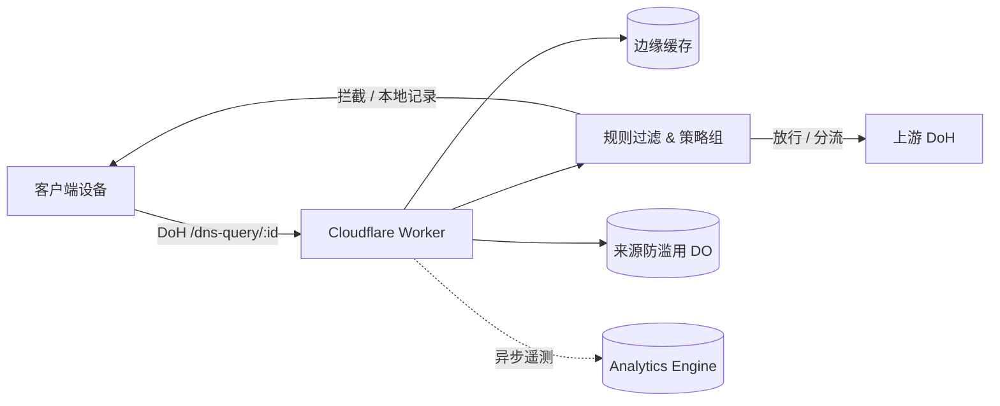

<div align="center">


# cf-dns

**简体中文** · [繁體中文](docs/README.zh-Hant.md) · [English](docs/README.en.md)

[](https://deploy.workers.cloudflare.com/?url=https://github.com/ChouChiu/cf-dns)

基于 Cloudflare Workers 构建的个人 DNS-over-HTTPS (DoH) 服务。支持按设备分配接入点、AdGuard 规则过滤、策略组管理、分流解析与 Web 管理面板。

</div>

## 架构概览



## 核心特性

- **DoH 接入点**：遵循 RFC 8484 规范（GET / POST），按设备分配独立路径，支持 Apple 描述文件（`.mobileconfig`）一键导入。
- **规则过滤**：兼容 AdGuard 语法、hosts 与纯域名列表；快照在浏览器端编译为 64 位哈希分片，Worker 节点以二分查找匹配，不消耗实时解析 CPU。
- **策略组管理**：支持按设备绑定策略组，独立配置生效列表、拦截响应模式、上游服务器、预设服务屏蔽（含定时屏蔽）、安全搜索与 YouTube 受限模式。
- **分流解析与 ECS**：支持按域名列表分流至专属上游；支持转发客户端 /24（IPv6 /56）EDNS Client Subnet 优化 CDN 调度。
- **ECH 与 HTTP/3 注入**：为 Cloudflare 代理的站点补充公共 ECH 与 HTTP/3 配置，加密握手域名并加速连接。
- **客户端防滥用**：基于 Durable Objects 限制单设备滑动窗口内的活跃网络数（IPv4 单 IP，IPv6 /64 网段），防止接入点泄露。
- **监控与管理面板**：基于 Analytics Engine 记录请求统计与实时查询日志；管理面板受 Cloudflare Access (Zero Trust) JWT 保护。

## 快速开始

本地开发依赖 [Bun](https://bun.sh) 与 Cloudflare 账号：

```bash
bun install
cp wrangler.example.jsonc wrangler.jsonc
cp .env.example .env
echo ACCESS_DEV_BYPASS=true >> .env
bun run db:migrate:local
bun run dev
```

启动后访问 `http://localhost:8787`。生产部署与远程配置请参考 [部署指南](docs/deploy.md)。

## 项目文档

- [部署指南](docs/deploy.md)：生产环境一键部署、Zero Trust 团队与 Access 规则配置。
- [技术实现文档](docs/TECHNICAL.md)：解析流水线详解、规则引擎架构、完整 API 接口与代码库结构。

## 许可证

本项目基于 [GNU AGPL v3](LICENSE) 开源。
