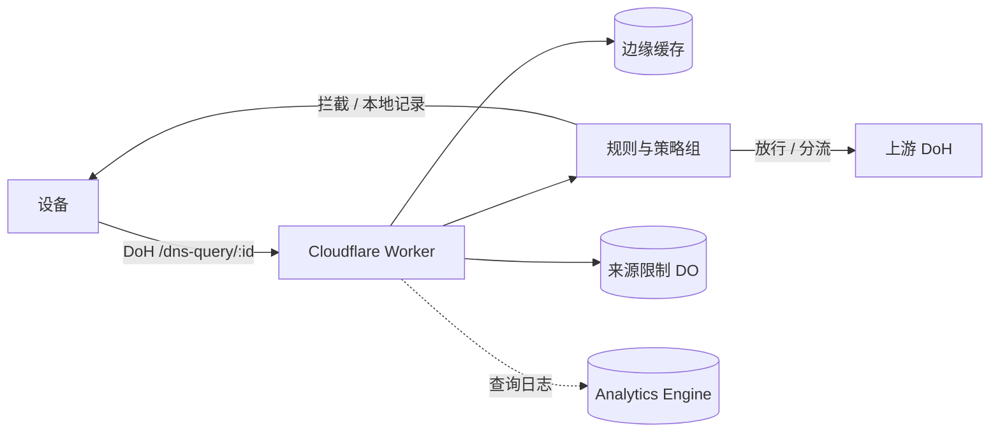

<div align="center">


# EdgeDoH

**简体中文** · [繁體中文](docs/README.zh-Hant.md) · [English](docs/README.en.md)

[](https://deploy.workers.cloudflare.com/?url=https://github.com/ChouChiu/EdgeDoH)

跑在 Cloudflare Workers 上的个人 DNS-over-HTTPS 服务，带过滤规则、策略组和管理面板。

</div>

## 工作方式



## 功能

- 每台设备一个 DoH 地址（RFC 8484，GET 和 POST），苹果设备可下载 `.mobileconfig` 描述文件。
- 过滤规则支持 AdGuard DNS 语法、hosts 和纯域名列表。规则在浏览器里编译成哈希分片存进 KV，Worker 只做二分查找，不解析规则文本。
- 策略组：每台设备可以绑定一个策略组，分别设置启用的列表、拦截方式、上游、要屏蔽的服务（可按时段）、安全搜索和 YouTube 受限模式。
- 分流：指定域名走指定上游；可选转发客户端子网（ECS，IPv4 /24、IPv6 /56）。
- 对 Cloudflare 代理的站点，可在 HTTPS 记录中补上 ECH 和 HTTP/3。
- 限制每台设备在一段时间内可使用的网络数（IPv4 按地址，IPv6 按 /64），DoH 地址泄露后不会被随意使用。
- 查询统计和日志写入 Analytics Engine；面板和 API 由 Cloudflare Access 保护。

## 本地运行

需要 [Bun](https://bun.sh)：

```bash
bun install
cp wrangler.example.jsonc wrangler.jsonc
cp .env.example .env
echo ACCESS_DEV_BYPASS=true >> .env
bun run db:migrate:local
bun run dev
```

打开 `http://localhost:8787`。部署到 Cloudflare 见[部署指南](docs/deploy.md)。

## 文档

- [部署指南](docs/deploy.md)：部署步骤、Zero Trust 与 Access 配置。
- [技术文档](docs/TECHNICAL.md)：解析流程、规则引擎、API 和目录结构。

## 许可证

[GNU AGPL v3](LICENSE)
