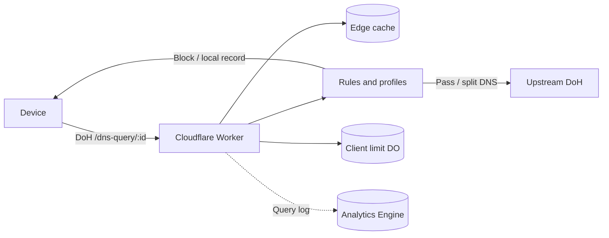

<div align="center">


# EdgeDoH

[简体中文](../README.md) · [繁體中文](README.zh-Hant.md) · **English**

[](https://deploy.workers.cloudflare.com/?url=https://github.com/ChouChiu/EdgeDoH)

A personal DNS-over-HTTPS resolver on Cloudflare Workers, with filter rules, profiles and a dashboard.

</div>

## How it works



## Features

- One DoH URL per device (RFC 8484, GET and POST); Apple devices can download a `.mobileconfig` profile.
- Filter rules in AdGuard DNS syntax, hosts files or plain domain lists. The browser compiles them into hashed shards stored in KV, so the Worker only runs binary searches and never parses rule text.
- Profiles: each device can use a profile with its own lists, blocking response, upstreams, blocked services (optionally on a schedule), safe search and YouTube restricted mode.
- Split DNS: send chosen domains to chosen upstreams; optionally forward the client subnet (ECS, IPv4 /24, IPv6 /56).
- For Cloudflare-proxied sites, ECH and HTTP/3 can be added to HTTPS records.
- Each device may be used from a limited number of networks over a time window (IPv4 by address, IPv6 by /64), so a leaked DoH URL cannot be used freely.
- Query stats and logs go to Analytics Engine; the dashboard and API sit behind Cloudflare Access.

## Run locally

Requires [Bun](https://bun.sh):

```bash
bun install
cp wrangler.example.jsonc wrangler.jsonc
cp .env.example .env
echo ACCESS_DEV_BYPASS=true >> .env
bun run db:migrate:local
bun run dev
```

Open `http://localhost:8787`. To deploy to Cloudflare, see the [deployment guide](deploy.en.md).

## Documentation

- [Deployment guide](deploy.en.md): deployment steps, Zero Trust and Access setup.
- [Technical notes](TECHNICAL.en.md): resolution pipeline, rule engine, API and code layout.

## License

[GNU AGPL v3](../LICENSE)
