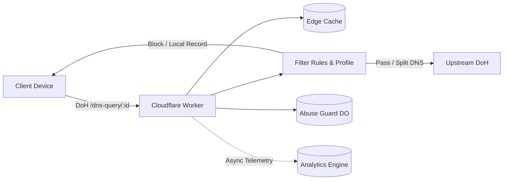

<div align="center">


# cf-dns

[简体中文](../README.md) · [繁體中文](README.zh-Hant.md) · **English**

[](https://deploy.workers.cloudflare.com/?url=https://github.com/ChouChiu/cf-dns)

A personal DNS-over-HTTPS (DoH) resolver built on Cloudflare Workers. Features per-device endpoints, AdGuard rule filtering, profile-based management, split DNS, and a web dashboard.

</div>

## Architecture Overview



## Key Features

- **DoH Endpoints**: RFC 8484 compliant (GET / POST), dedicated endpoint per device, and one-click Apple configuration profile (`.mobileconfig`) export.
- **Rule Filtering**: Compatible with AdGuard DNS syntax, hosts files, and plain domain lists. Snapshots are compiled in the browser into 64-bit hashed binary shards for fast in-memory binary search at the edge.
- **Per-Device Profiles**: Assign profiles to devices to control active filter lists, blocking responses, upstream resolvers, scheduled service blocking, Safe Search, and YouTube Restricted Mode.
- **Split DNS & ECS**: Route specific domains to designated upstreams; forward client /24 (IPv6 /56) EDNS Client Subnets for CDN optimization.
- **ECH & HTTP/3 Injection**: Inject public ECH configurations and advertise HTTP/3 for Cloudflare-proxied domains.
- **Abuse Protection**: SQLite-backed Durable Objects track active networks in a sliding window (IPv4 by IP, IPv6 by /64 prefix) to prevent endpoint abuse.
- **Monitoring & Dashboard**: Analytics Engine tracks query metrics and real-time logs; management dashboard and APIs are secured by Cloudflare Access (Zero Trust) JWT.

## Quick Start

Requires [Bun](https://bun.sh) and a Cloudflare account:

```bash
bun install
cp wrangler.example.jsonc wrangler.jsonc
cp .env.example .env
echo ACCESS_DEV_BYPASS=true >> .env
bun run db:migrate:local
bun run dev
```

Visit `http://localhost:8787`. For production deployment and remote configuration, see the [Deployment Guide](deploy.en.md).

## Documentation

- [Deployment Guide](deploy.en.md): Production deployment steps, Zero Trust team setup, and Cloudflare Access rules.
- [Technical Documentation](TECHNICAL.en.md): Detailed resolution pipeline, rule engine architecture, API reference, and codebase structure.

## License

Released under the [GNU AGPL v3](../LICENSE).
