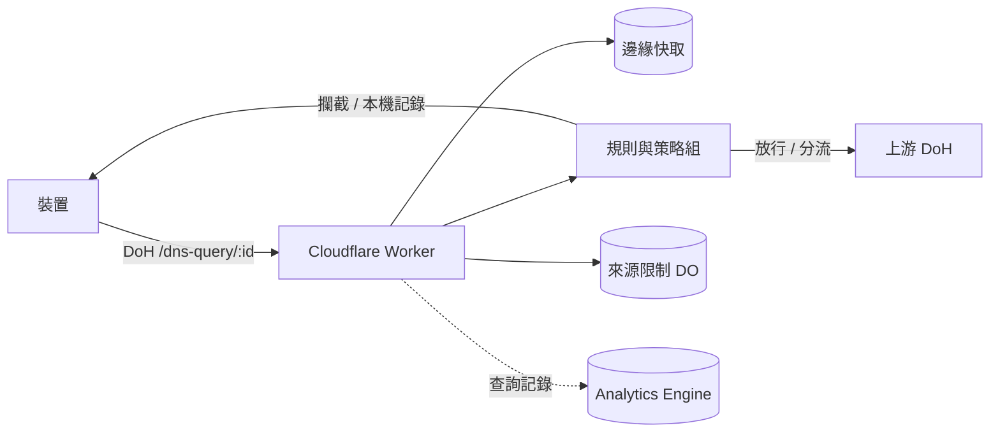

<div align="center">


# EdgeDoH

[简体中文](../README.md) · **繁體中文** · [English](README.en.md)

[](https://deploy.workers.cloudflare.com/?url=https://github.com/ChouChiu/EdgeDoH)

執行於 Cloudflare Workers 的個人 DNS-over-HTTPS 服務，提供過濾規則、策略組與管理面板。

</div>

## 運作方式



## 功能

- 每台裝置一個 DoH 位址（RFC 8484，GET 與 POST），Apple 裝置可下載 `.mobileconfig` 描述檔。
- 過濾規則支援 AdGuard DNS 語法、hosts 與純網域清單。規則在瀏覽器中編譯成雜湊分片存入 KV，Worker 只做二分搜尋，不解析規則文字。
- 策略組：每台裝置可綁定一個策略組，分別設定啟用的清單、攔截方式、上游、要封鎖的服務（可依時段）、安全搜尋與 YouTube 限制模式。
- 分流：指定網域走指定上游；可選擇轉送用戶端子網路（ECS，IPv4 /24、IPv6 /56）。
- 對 Cloudflare 代理的網站，可在 HTTPS 記錄中補上 ECH 與 HTTP/3。
- 限制每台裝置在一段時間內可使用的網路數（IPv4 依位址，IPv6 依 /64），DoH 位址外洩後不會被任意使用。
- 查詢統計與記錄寫入 Analytics Engine；面板與 API 由 Cloudflare Access 保護。

## 本機執行

需要 [Bun](https://bun.sh)：

```bash
bun install
cp wrangler.example.jsonc wrangler.jsonc
cp .env.example .env
echo ACCESS_DEV_BYPASS=true >> .env
bun run db:migrate:local
bun run dev
```

開啟 `http://localhost:8787`。部署至 Cloudflare 請見[部署指南](deploy.zh-Hant.md)。

## 文件

- [部署指南](deploy.zh-Hant.md)：部署步驟、Zero Trust 與 Access 設定。
- [技術文件](TECHNICAL.zh-Hant.md)：解析流程、規則引擎、API 與目錄結構。

## 授權

[GNU AGPL v3](../LICENSE)
