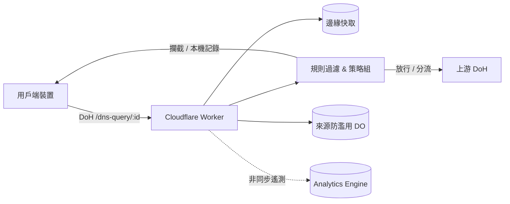

<div align="center">


# EdgeDoH

[简体中文](../README.md) · **繁體中文** · [English](README.en.md)

[](https://deploy.workers.cloudflare.com/?url=https://github.com/ChouChiu/EdgeDoH)

基於 Cloudflare Workers 建構的個人 DNS-over-HTTPS (DoH) 服務。支援依裝置分配接入點、AdGuard 規則過濾、策略組管理、分流解析與 Web 管理面板。

</div>

## 架構概覽



## 核心特性

- **DoH 接入點**：遵循 RFC 8484 規範（GET / POST），依裝置分配獨立路徑，支援 Apple 描述檔（`.mobileconfig`）一鍵匯入。
- **規則過濾**：相容 AdGuard 語法、hosts 與純網域清單；快照在瀏覽器端編譯為 64 位元雜湊分片，Worker 節點以二分搜尋比對，不消耗即時解析 CPU。
- **策略組管理**：支援依裝置綁定策略組，獨立設定生效清單、攔截回應模式、上游伺服器、預設服務封鎖（含定時封鎖）、安全搜尋與 YouTube 嚴格篩選模式。
- **分流解析與 ECS**：支援依網域清單分流至專屬上游；支援轉送用戶端 /24（IPv6 /56）EDNS Client Subnet 最佳化 CDN 調度。
- **ECH 與 HTTP/3 注入**：為 Cloudflare 代理的網站補上公用 ECH 與 HTTP/3 設定，加密交握網域並加速連線。
- **用戶端防濫用**：基於 Durable Objects 限制單台裝置滑動區間內的活躍網路數（IPv4 單 IP，IPv6 /64 網段），防止接入點外洩。
- **監控與管理面板**：基於 Analytics Engine 記錄請求統計與即時查詢日誌；管理面板受 Cloudflare Access (Zero Trust) JWT 保護。

## 快速開始

本機開發依賴 [Bun](https://bun.sh) 與 Cloudflare 帳號：

```bash
bun install
cp wrangler.example.jsonc wrangler.jsonc
cp .env.example .env
echo ACCESS_DEV_BYPASS=true >> .env
bun run db:migrate:local
bun run dev
```

啟動後存取 `http://localhost:8787`。正式部署與遠端設定請參考 [部署指南](deploy.zh-Hant.md)。

## 專案文件

- [部署指南](deploy.zh-Hant.md)：正式環境一鍵部署、Zero Trust 團隊與 Access 規則設定。
- [技術實作文件](TECHNICAL.zh-Hant.md)：解析流程詳解、規則引擎架構、完整 API 介面與程式碼庫結構。

## 授權條款

本專案基於 [GNU AGPL v3](../LICENSE) 開源。
